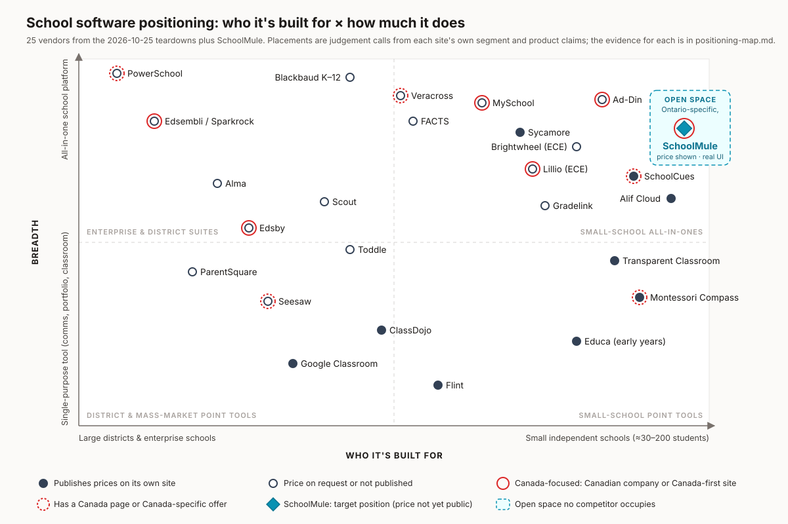

# Positioning map: where SchoolMule can stand

Back to the [main report](README.md). Every vendor below was torn down on 2026-10-25; the full rows are in [teardown-table.md](teardown-table.md).

## How to read it

- **x axis, who it's built for.** Left: large districts, boards and enterprise or international schools. Right: small independent schools of about 30–200 students. Placement is judged from each vendor's own segment claims, customer logos and scale numbers.
- **y axis, breadth.** Bottom: single-purpose tools (communication, portfolio, classroom or LMS). Top: all-in-one school platforms (student records, grades and report cards, parent communication, plus admissions, finance or operations). Placement is judged from the modules each site lists.
- **Filled dot:** the vendor publishes prices on its own site. **Hollow dot:** price on request, or not published for schools.
- **Solid red ring, Canada-focused:** a Canadian company, or a site whose main positioning is Canada-first. **Dashed red ring:** a dedicated Canada page or Canada-specific offer on an otherwise non-Canadian site.
- **Teal diamond:** SchoolMule's target position. SchoolMule is marked Canada-focused as an Ontario-built company whose schools are in Ontario; its data is hosted in the United States ([feature verification §2](notes/feature-verification.md)). It does not publish a price yet.

These placements are **judgement calls (inference)**, not measurements. Small vertical or horizontal differences inside a cluster (for example SchoolCues and Alif Cloud, or Sycamore and Brightwheel) were nudged for legibility and are not meaningful.

## Placement of each vendor, with its evidence

| Vendor | Placement | Evidence |
|---|---|---|
| PowerSchool | Far left, top; dashed ring; hollow | "unifying education ecosystems for over 60 million students in 90 countries"; broadest K-12 suite (SIS, LMS, ERP, HR, analytics); Canada page for boards ("used by 76 percent of students in Canada"), nothing for private schools; no public price ([powerschool](https://www.powerschool.com/), [Canada page](https://www.powerschool.com/global/north-america/canada/)) |
| Edsembli / Sparkrock | Left, high; solid ring; hollow | Now Sparkrock K-12, selling "finance, HR, student information, and school-generated funds management" to Canadian public boards (Niagara, Waterloo Catholic, Central Okanagan); no independent-school path; no price ([sparkrock.com/k12](https://sparkrock.com/k12/)) |
| ParentSquare | Left, lower-middle; hollow | "The K-12 family engagement platform", 42,000+ schools with district seals; broad communications suite (messaging, websites, attendance outreach, payments) but no SIS; "US-based data storage and processing"; "Contact sales" ([parentsquare](https://www.parentsquare.com/), [security](https://www.parentsquare.com/platform/security-and-compliance/)) |
| Alma | Left of centre, upper-middle; hollow | Moving to states and districts ("From the classroom to the capitol"), independent schools one column of three; SIS plus AI analytics; named tiers with no prices ([getalma](https://www.getalma.com/), [packages](https://www.getalma.com/alma-packages-for-prek-12-independent-charter-schools/)) |
| Edsby | Left of centre, middle; solid ring; hollow | Ontario boards plus independent secondary schools ("More than 80 independent schools"); learning platform, gradebook, report cards and parent engagement beside an SIS; Canadian hosting on Azure for Canadian customers; no price ([edsby](https://www.edsby.com/), [privacy & data](https://edsby.com/about-privacy-data/)) |
| Seesaw | Left of centre, low; dashed ring; hollow | PreK–6 schools and districts; LMS, portfolio and family communication; Canada page with PIPEDA/MFIPPA claims and "590,000+" Canadian users but no hosting or CAD offer; "Talk To Sales" ([seesaw](https://seesaw.com/), [Canada](https://seesaw.com/canada/)) |
| Google Classroom | Centre-left, bottom; filled | All K-12 and higher education, global; coursework only, no attendance registers, report cards or SIS; Fundamentals at no cost, Education Plus C$7.80 per user per year (CAD pricing is localisation, so no ring) ([Classroom](https://edu.google.com/workspace-for-education/products/classroom/), [editions](https://edu.google.com/intl/ALL_ca/workspace-for-education/editions/compare-editions/)) |
| Scout | Centre-left, upper-middle; hollow | YC W25 "AI-powered student information system for K-12 schools", sold to California and Oregon schools and districts (county office of education seals); enrolment, compliance, reporting and student success modules; direct Calendly, no price ([scoutforschools](https://scoutforschools.com), [YC](https://www.ycombinator.com/companies/scout-4)) |
| Toddle | Centre-left, middle; hollow | IB, international and independent schools plus districts; teaching and learning (planning, LMS, report cards, communication), not admin SIS; "tiered pricing based on the number of users", no numbers; a Toronto meetup only ([toddle](https://www.toddleapp.com/), [pricing](https://www.toddleapp.com/pricing/)) |
| Blackbaud K–12 | Centre, top; hollow | Larger US private, independent and Catholic schools with a fundraising arm; broadest private-school suite (SIS, LMS, admissions, tuition, accounting, fundraising, website); "Ask About Pricing", Software Advice lists from $21,000 a year ([blackbaud k-12](https://www.blackbaud.com/who-we-serve/k-12-schools), [Software Advice](https://www.softwareadvice.com/k-12/blackbaud-k-12-profile/)) |
| ClassDojo | Centre, low; filled | US K-8 mass market, teacher-adopted ("45 million students and parents"); communication, behaviour and portfolios, not an SIS; "always free for schools, teachers, and now districts", families pay for an optional plan ([classdojo](https://www.classdojo.com/), [school leaders](https://www.classdojo.com/school-leaders/)) |
| Veracross | Centre, top; dashed ring; hollow | "The one-person, one-record school management platform for private and independent K-12 schools", 3300+ schools and big-name preps; SIS, admissions, development, accounting, tuition, health; Canada pop-up ("over a dozen independent schools") and a Canada page with OnSIS reporting; no price ([veracross](https://www.veracross.com/), [Canada](https://www.veracross.com/canada/)) |
| FACTS | Centre, high; hollow | US independent, Catholic and diocesan, and Christian schools ("12K+ Schools"); all-in-one with tuition and payments at the core; Canada only as a country picker; "CONTACT SALES" ([factsmgt](https://factsmgt.com/)) |
| Flint | Centre-right, bottom; filled | YC S23 "Personalized learning built for schools", independent-school logos; AI learning tool only; free up to 80 users, then $3,000 / $4,000 / $6,500 a year ([flintk12](https://www.flintk12.com), [pricing](https://flintk12.com/pricing)) |
| MySchool | Right of centre, top; solid ring; hollow | "The K-12 School Management Ecosystem Built For Canadian Schools" with OnSIS/OUAC/OCAS, Canadian hosting, PIPEDA and CAD invoicing; logos of mid-to-large Canadian schools (Brentwood, Crofton House); SIS, admissions, tuition, communication, LMS, donations, IEP; no price ([trymyschool](https://www.trymyschool.com/)) |
| Sycamore | Right, high; filled | Small and mid US faith and independent schools (Christian, Catholic, Lutheran pages); all-in-one; "$4 per student per month with every module included"; no Canada content ([sycamoreleaf](https://sycamoreleaf.com/), [pricing](https://sycamoreleaf.com/pricing/)) |
| Lillio (ECE) | Right, high-middle; solid ring; hollow | Childcare centres, single to multi-location; all-in-one childcare plus curriculum kits and training; Toronto-headquartered, though the site speaks in US terms; every product "Get a quote" ([lillio](https://www.lillio.com/), [pricing](https://www.lillio.com/features/pricing), [HQ](https://app.welcometothejungle.com/companies/Lillio)) |
| Gradelink | Right, middle; hollow | Small and mid US private schools ("2,200+ Schools"); core SIS plus websites; price only via an emailed quote on its own site (Capterra lists about $114 a month for up to 50 students); no Canada features ([gradelink](https://www.gradelink.com/), [quote site](https://buy.gradelink.com/), [Capterra](https://capterra.com/p/118900/Gradelink-SIS/)) |
| Brightwheel (ECE) | Right, high; hollow | US early-childhood programs (preschools, centres, Montessori, camps), single to multisite; all-in-one childcare (billing, payroll, admissions, curriculum, communication); price via a six-step quiz; Canada only in an FAQ line ([brightwheel](https://mybrightwheel.com/), [pricing](https://mybrightwheel.com/pricing/)) |
| Ad-Din | Right, top; solid ring; hollow | Canadian (Ontario-heavy) mosques, madrasahs and full-time Islamic JK–12 schools; very broad (prayer-time displays, donations, websites, SIS, gradebook, Hifz, Ontario Ministry-style report cards); masjid tiers public but the school price hidden in a configurator ([ad-din.ca](https://www.ad-din.ca/), [pricing](https://www.ad-din.ca/pricing)) |
| SchoolCues | Far right, high-middle; dashed ring; filled | "School Management Solutions Simplified for Small Schools", small and micro US faith and Montessori schools; all-in-one lite (SIS, admissions, payments, gradebook, donations, alumni); "As low as $75.00/mo"; templated "Canadian Schools" page ([schoolcues](https://www.schoolcues.com/), [Canada page](https://www.schoolcues.com/canadian-schools.html)) |
| Alif Cloud | Far right, high-middle; filled | "Purpose-built for Islamic schools" across North America (Toronto named in its meta); enrolment, records, Quran progress, attendance, billing, messaging; free up to 30 students, then $1.49 per student a month; no Ontario report cards or residency ([alifcloud](https://www.alifcloud.com/), [pricing](https://www.alifcloud.com/pricing)) |
| Educa (early years) | Right, low; filled | Early-years learning stories from New Zealand, with some schools; portfolio, family communication and planning; $1.29–$1.59 per child a month, 15-child minimum ([geteduca](https://www.geteduca.com/), [pricing](https://www.geteduca.com/pricing/)) |
| Transparent Classroom | Far right, lower-middle; filled | "Designed by Montessorians, for Montessorians", "over 3000 Montessori schools"; records, lesson planning, parent sharing, forms, enrolment, attendance; "$2.00 USD per child / month"; no Canada pitch ([transparentclassroom](https://www.transparentclassroom.com/)) |
| Montessori Compass | Far right, low-middle; dashed ring; filled | Montessori schools, small and owner-led; record keeping, family communication, light admin; $2.00 or $1.50 USD per student a month, $2.50 CAD on a Canada page that says "Your student data stays in Canada" ([montessoricompass](https://www.montessoricompass.com/), [Canada](https://www.montessoricompass.com/canada/)) |
| **SchoolMule** | Far right, high; solid ring; target | Built for 30–200-student JK–8 independent schools; shipped: student records, weighted gradebook, Ontario-style report cards, JK/SK skill reports, parent portal, messaging, announcements, optional student portal with quizzes, timetable generator, staff hours, forms, analytics; a QuickBooks tuition mirror but no invoicing, payments, donations or website builder, so it sits just below the broadest suites ([feature verification §1](notes/feature-verification.md)) |

Maplewood is not plotted because its site was down on 2026-10-25; it was a legacy Ontario SIS (about 2,000 schools at peak) acquired by Edsembli in 2019 ([Edsby on Maplewood](https://www.edsby.com/integration/maplewood/)).

## The open space SchoolMule should claim

The small-school, all-in-one corner is not empty: SchoolCues, Alif Cloud, Sycamore and Ad-Din are all there. What nobody in it combines is the set of four things the buyer research says a small Ontario principal wants before booking a call:

1. **Ontario-specific product proof.** Ad-Din has it, but only for Islamic institutions alongside mosque software, and MySchool has it for mid-to-large schools. SchoolCues' Canadian page is a template and Sycamore and Alif Cloud have none ([SIS teardowns](notes/teardowns-category-sis.md), [comms teardowns](notes/teardowns-category-comms.md)).
2. **A price on the page.** SchoolCues, Alif Cloud and Sycamore publish one; Ad-Din hides the school price and MySchool publishes none ([TrustRadius](https://www.trustradius.com/blog/tech-buyers-demand-honest-and-up-front-pricing-info), [EdWeek](https://www.edweek.org/advertise/the-wired-marketer-advice-from-k-12-leaders-to-vendors-they-dont-mince-words-2-25-25/2025/03) on why it matters).
3. **Real product screens of the things a JK–8 school produces**: report cards, kindergarten skills reports, a parent's phone view. No SIS vendor shows these ([SIS teardowns](notes/teardowns-category-sis.md)).
4. **Every school type, not one.** Ad-Din and Alif Cloud are Islamic-only and Montessori Compass and Transparent Classroom Montessori-only, while SchoolMule's pipeline is 115 Islamic, 104 Montessori and 73 secular schools ([dossier synthesis](notes/dossier-synthesis.md)).

So the claim is: **the all-in-one system for small Ontario independent schools (JK–8, every faith and method), with the price and the real screens on the page.** SchoolMule can make the first and fourth parts today; the second needs a founder decision on price, and the third needs fresh captures from the demo school. The one Canadian trust signal competitors use that SchoolMule cannot (yet) match is **Canadian data residency**, offered by MySchool, Edsby and Montessori Compass; until SchoolMule's data moves to a Canadian region, the site must say it is hosted in the United States ([feature verification §2](notes/feature-verification.md)).

A different cut of the same data reaches the same conclusion. The SIS researcher plotted segment size against Canada/Ontario fit and found the quadrant for "small independent JK–8 school with deep Ontario fit" empty, with MySchool, Edsby, PowerSchool and Sparkrock holding Canada fit only for larger institutions ([SIS teardowns, positioning data](notes/teardowns-category-sis.md)).

## Who to watch

- **MySchool** already says "Built For Canadian Schools" and OnSIS, and sponsors CIS Ontario; SchoolMule's difference must be JK–8, under 200 students and a visible price, not just "Canadian".
- **Ad-Din** is the confirmed incumbent at one SchoolMule prospect (IIT Academy) with a portal link at another, has a free tier and an Ontario city-labelled logo wall, and is the comparison every Islamic-school principal can make.
- **Montessori Compass** is the most copyable Canada page (residency, CAD, PIPEDA, Montessori Canada offer) and will be the comparison for any Montessori page.
